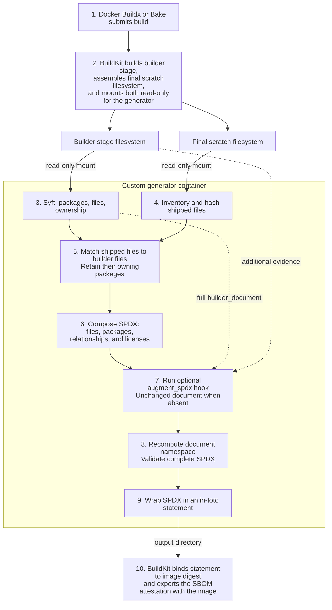

# CNPG SBOM generator

A standalone BuildKit SBOM scanner for container images assembled from a builder
stage. It uses Syft to identify packages in the builder, matches them to files
shipped in the final image, and produces a validated SPDX 2.3 software bill of
materials with package, checksum, and license evidence.

The main consumer is [cnpg-extensions](https://github.com/cnpg-extensions), which
uses it for PostgreSQL extension images. Any compatible BuildKit build can use
the published scanner image without checking out this repository.

## Compatibility

This project is designed to be fully compatible with
[cloudnative-pg/postgres-containers](https://github.com/cloudnative-pg/postgres-containers).
The goal is for SBOMs and provenance to have the same formats and presentation,
to be generated with the same tools wherever possible, and for users to use the
exact same commands to inspect, extract, verify, and report on them wherever
possible. Compatibility with that project is a design requirement for changes
to the generator and its integration.

This means preserving Syft's SPDX conventions, using BuildKit's standard SBOM
attestations and provenance, and retaining the familiar Docker Buildx, Cosign,
Grype, and Grant workflows. Image references, signing identities, source
repositories, and inventory contents naturally vary by publisher and image.
The generator scopes package evidence to the shipped payload; consumer build
workflows generate provenance and signatures. Full compatibility therefore
includes those workflows as well as the scanner.

## How it works


The builder scan follows [BuildKit's default Syft generator](https://github.com/docker/buildkit-syft-scanner/blob/master/internal/target.go)
to keep inventory behavior aligned with that scanner and the compatibility
goal above. The generator scopes those
results to files shipped in the final scratch image, applies any custom
augmentation, and validates the resulting SPDX document. Review scan alignment
when updating Syft or BuildKit's default scanner.



Files move when copied into the scratch image: for example,
`/usr/share/doc/gcc-12-base/copyright` becomes `/licenses/gcc-12-base/copyright`.
The generator matches shipped files to their original builder paths and checksums
to recover package ownership.

## Consumer integration


Name the stage containing the package database and original files `builder`,
and expose it to the scanner:

```dockerfile
FROM debian:bookworm-slim AS builder
ARG BUILDKIT_SBOM_SCAN_STAGE=builder
# Build or install your software and collect runtime files in /payload.
# Include the corresponding license notices in that payload.

FROM scratch
COPY --from=builder /payload/ /
```

Select a checked generator image digest and pass it to Docker Buildx:

```bash
GENERATOR='ghcr.io/cnpg-extensions/cnpg-sbom-generator:latest@sha256:<checked-index-digest>'
IMAGE='your-registry/your-image:tag'

docker buildx build \
  --attest "type=sbom,generator=$GENERATOR" \
  --provenance=mode=max --tag "$IMAGE" --push .
```

Replace the digest placeholder with a published image index digest. Pinning the
digest keeps builds reproducible when the `latest` tag moves. Generator images
support Linux AMD64 and ARM64.

## Inspect an image

### Verify the image and extract its SBOM

Use Docker Buildx to extract the attached SPDX document. Extraction alone does
not verify the publisher. For a signed image, first verify its digest with
Cosign using the workflow identity supplied by its publisher:

```bash
IMAGE='your-registry/your-image@sha256:<checked-index-digest>'
IDENTITY='https://github.com/OWNER/REPO/.github/workflows/WORKFLOW.yml@refs/heads/main'

cosign verify "$IMAGE" \
  --certificate-identity="$IDENTITY" \
  --certificate-oidc-issuer='https://token.actions.githubusercontent.com'

docker buildx imagetools inspect "$IMAGE" \
  --format '{{ json (index .SBOM "linux/amd64").SPDX }}' \
  > image.spdx.json
```

Replace the image and identity placeholders with the publisher's values. This
identity example applies to GitHub Actions keyless signing. Use `linux/arm64`
to inspect the ARM image.

### Inspect and verify build provenance

For images built with BuildKit provenance enabled, inspect the recorded build
inputs and parameters:

```bash
docker buildx imagetools inspect "$IMAGE" \
  --format '{{ json (index .Provenance "linux/amd64").SLSA }}'
```

The `.SLSA` field exposes BuildKit's SLSA-format provenance. Inspecting it shows
build details; it does not by itself verify the publisher. Verify the image
index with Cosign as shown above. Its signature binds the platform manifests
and their attached SBOM and provenance attestations.

This is the approach used by `cloudnative-pg/postgres-containers` and by the
generator image itself. A separate SLSA-generator workflow is not needed to
match that project. See the [architecture rationale](ARCHITECTURE.md#signing-and-provenance-design)
for the distinction and design choice.

### Report vulnerabilities and licenses

```bash
grype sbom:image.spdx.json --ignore-states wont-fix | grep -E 'NAME|High|Critical'
grant list image.spdx.json
```

The grep filter shows High and Critical findings. `--ignore-states wont-fix`
excludes findings marked "won't fix".
Omit the filters for the complete report; add `--only-fixed` to Grype to show only findings
with a known fix. Grant reports all package licenses.
To list packages associated with a license or inspect one package:

```bash
grant list image.spdx.json MIT
grant list image.spdx.json GPL-3.0-or-later --pkg gcc-12-base
```

See the [example report commands](examples/sbom-reports.txt) for an OGR FDW
Bookworm build. Scan the extracted SPDX: a direct filesystem scan of the scratch image
cannot recover its missing Debian package database. Findings depend on the
scanner's vulnerability database and supported package ecosystems.

#### Reading license results

`grant list` groups packages by license. The `LICENSE` column can contain a
name such as `MIT`, an expression combining licenses with `AND` or `OR`, or a
64-character hexadecimal checksum. The `PACKAGES` column counts packages
associated with each entry; a package can appear under several entries.

A checksum identifies the original notice text when its license could not be
identified. It is the notice's SHA256 checksum, so packages sharing the same
notice can appear under the same checksum. Grant usually labels these entries
`Unknown` in the `RISK` column because it has no risk classification for that
identifier. Retrieve the notice to read its terms.

#### Retrieve an original notice

Start with a checksum from `grant list`. For example, the
[OGR FDW report](examples/sbom-reports.txt) contains this entry. With
`ogr-fdw.spdx.json` from that build, list its associated packages:

```bash
CHECKSUM=da8191658b3452ce9caf31638ba61dab31a38c619fa39df119812e050f592fd3
grant list ogr-fdw.spdx.json "$CHECKSUM"
```

Find shipped notice paths with that SHA256 checksum:

```bash
jq -r --arg checksum "$CHECKSUM" '
  .files[] |
  select(any(.checksums[]?;
    .algorithm == "SHA256" and .checksumValue == $checksum)) |
  .fileName' ogr-fdw.spdx.json
# licenses/libgfortran5/copyright
# licenses/libgomp1/copyright
# licenses/libquadmath0/copyright
```

These paths contain identical copies of the shared GCC notice. Choose one of
the returned paths and copy it from the same image used to produce the SBOM.
For the locally generated example, the image is `ogr-fdw:syft-only-example`;
replace `IMAGE` when inspecting another build. No shell inside the scratch
image is needed:

```bash
IMAGE=ogr-fdw:syft-only-example
NOTICE=licenses/libgomp1/copyright
CONTAINER=$(docker create --platform linux/amd64 "$IMAGE" /unused)
docker cp "$CONTAINER:/$NOTICE" ./original-notice
docker rm "$CONTAINER"
sha256sum ./original-notice
# da8191658b3452ce9caf31638ba61dab31a38c619fa39df119812e050f592fd3  ./original-notice
```

Read `original-notice` for the license terms. Shared Debian notices can cover
several libraries and include terms for code beyond a single shipped binary.

## Add custom inventory


To add components that the builder scan cannot identify, such as Rust crates,
Go modules, or Python distributions, install a Python file at
`/usr/local/share/cnpg-sbom/augment_spdx.py` in the `builder` stage.
It must export `augment_spdx(document, context)` and return the updated SPDX
JSON dictionary. For example, copy your hook into the builder:

```dockerfile
COPY augment_spdx.py /usr/local/share/cnpg-sbom/augment_spdx.py
```

The hook runs after the generator composes the inventory and before SPDX
validation. Add package records, licenses, and relationships using normal SPDX
2.3 fields; see the [small fixture hook](tests/integration/fixture/augment_spdx.py)
for an example.

[The context](hooks.py) provides `api_version` (currently `1`), `extension_name`,
`platform`, `builder_path`, `final_path`, and the full Syft `builder_document`.
Treat that builder evidence as read-only; filesystem paths last only for this
invocation. The hook runs as trusted code inside the generator, using its Python
standard library and installed dependencies. Prepare any additional evidence as
files in the builder; the builder's own Python dependencies are not available.

Without a hook, the inventory is unchanged. Hook errors or invalid resulting
SPDX fail the build. Keep required license notices in the final image; adding a
package declaration does not copy notice files there.

## Verify the generator image

The generator image itself carries a BuildKit SPDX SBOM and SLSA-format
`mode=max` provenance as OCI artifacts. Published images are signed with Cosign using
GitHub Actions OIDC, following the same approach as
[Postgres containers](https://github.com/cloudnative-pg/postgres-containers).
Use the same inspection commands with the generator image reference:

```bash
IMAGE='ghcr.io/cnpg-extensions/cnpg-sbom-generator@sha256:<checked-index-digest>'

cosign verify "$IMAGE" \
  --certificate-identity='https://github.com/cnpg-extensions/cnpg-sbom-generator/.github/workflows/sbom-generator.yml@refs/heads/main' \
  --certificate-oidc-issuer='https://token.actions.githubusercontent.com'

docker buildx imagetools inspect "$IMAGE" \
  --format '{{ json (index .SBOM "linux/amd64").SPDX }}'

docker buildx imagetools inspect "$IMAGE" \
  --format '{{ json (index .Provenance "linux/amd64").SLSA }}'
```

Use the publisher's actual workflow identity for images built in a fork or on
another branch. Older images retain the identity and attestation format of the
workflow that published them. These commands match the Postgres containers
workflow, with only the image reference and publisher identity changed.

## Further reading

- [Architecture and implementation](ARCHITECTURE.md)
- [Dependency workarounds](WORKAROUNDS.md)

## License

[Apache-2.0](LICENSE).
